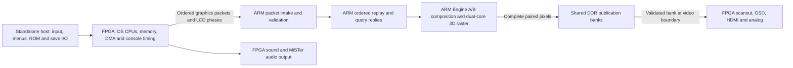

# Architecture — standalone and private performance beta

Updated 17 October 2026. This describes the current matched-screen design and
accepted final Castlevania worker-range runtime. See [the private beta freeze](PRIVATE_BETA_20261017.md)
for the exact package, component identities and final experiment decision.
The published release remains v0.9.0-rc.8. Historical experiment reports describe
their named builds, not necessarily the selected runtime.

## Hardware and software responsibilities

NDS4MiSTer runs DS CPU execution and console timing in the FPGA. The dual-core
Cortex-A9 HPS runs ordered graphics replay, both 2D engines, 3D geometry and
software rasterization. It composes complete Main/Touch pictures for FPGA
scanout. It does not run the DS CPUs in a headless melonDS emulator.

| Subsystem | Owner | Contract |
| --- | --- | --- |
| ARM9/ARM7 execution, interrupts, IPC, timers, DMA | FPGA | Console time and architectural ordering remain in hardware. |
| Cartridge, RAM, VRAM, palette and OAM interfaces | FPGA, with ordered graphics mirrors on ARM | ARM replay must preserve mapping, access width, byte enables and LCD-phase dependencies. |
| Engine A and Engine B 2D, windows, blending, display capture | ARM renderer | Both screens are composed from the same ordered state; capture memory effects remain active. |
| 3D command execution, matrices, clipping, geometry, rasterization | ARM renderer | Vendored melonDS with exact-output optimizations and guarded per-game policies. |
| Sound synthesis | FPGA | Nitro_DarkSide sound engine; the ARM graphics service does not mix audio. |
| Screen-pair publication | ARM writes, FPGA validates/adopts | Complete banks and ownership fences prevent partially updated pictures. |
| Video timing, scaling, OSD and analog/digital routing | FPGA/MiSTer video framework | Digital and native analog layouts can differ. |
| Menus, evdev input, ROM loading, save-file I/O | Standalone ARM host | Sole frontend/SPI owner after ordinary MiSTer exits. |
| DS RTC calendar and serial interface | FPGA | Host seeds local time and persists guest clock edits. |
| Launch, hash checks, clock setup and recovery | Launcher, supervisor, Kickstart and recovery guard | Matching components are an indivisible installation. |

The earlier architecture with FPGA Engine A and no Engine B is historical.
It is not the standalone package's rendering path.

## Data flow

The host uploads a selected ROM and the FPGA creates the direct-boot environment.
Built-in FreeBIOS/generated firmware support normal game loading; optional native
firmware boot is a separate path. ROMs up to 256 MiB require all-FF padding above
252 MiB; larger supported layouts up to 512 MiB require it above 316 MiB. File
size alone is not compatibility. See [development](DEVELOPMENT.md) and
[firmware protocol](DS_FIRMWARE_PROTOCOL.md).

## Ordered graphics pipeline

1. FPGA captures GX commands, graphics registers, VRAM mapping/writes,
   palette/OAM writes and LCD phase records. It commits packet contents before
   their sequence. Backpressure must not drop, repeat or reorder accepted work.
2. Intake validates packet headers, bounds, records, session and commit state,
   copies accepted input into a reserved private ring slot, returns shared-packet
   credit, and release-publishes that owned copy to ordered replay. Transport
   acknowledgement does not mean replay, native GX retirement or display is done.
3. Replay advances the GPU state and query responses in order. Delayed replay,
   readback queries and geometry backlog can stall the guest even if rendering
   alone appears fast. A publication counter cannot measure guest CPU progress.
4. The renderer prepares 3D and 2D work while preserving phase-dependent sprite
   preparation, display capture, windows, palette/VRAM coherence and screen identity.
5. An owned output slot receives both final screens. The current direct-output
   path fuses conversion into write-combined framebuffer banks where eligible.
   Unchanged 3D reuse does not permit arbitrary whole-frame state reuse.
6. Publication waits for completed work, checks ownership and commits metadata
   after pixels. FPGA changes the display bank only at a video frame boundary.

The code retains older 3D-plane and split-renderer modes for tests/compatibility.
The normal matched-screen path publishes complete screen pairs. A late frame can
repeat an older complete picture; do not describe it as independently full-speed
FPGA 2D with only a transparent missing 3D line.

## Threads and scheduling

These affinities describe the accepted package, not every environment override.

| Work | CPU placement | Reason to audit |
| --- | --- | --- |
| Packet intake and primary raster worker | CPU0 | They contend for the same Cortex-A9 under live load. |
| Ordered replay and secondary raster worker | CPU1 | Renderer overlap and query dependencies affect available time. |
| Bounded publication worker | CPU0, elevated publication priority | A completed image needs prompt display-facing progress. |
| Low-rate flight recorder | Idle scheduling priority | Diagnostic work must not be confused with free instrumentation. |

`Hybrid3DService.cpp` establishes ownership and affinity. `GPU3D_Soft.cpp` owns
raster partitioning, completion fences and policy selection. The verified
Castlevania profile uses the existing completion-adaptive two-way split; ordinary
games retain the four-band policy, warm-up/hysteresis and shadow/AA safety gates.
Both worker completion and final-pass ownership remain mandatory.

Post-freeze measurements preserve this placement. Moving publication to CPU1
with the exact frozen helper reduced throughput in both Castlevania rooms and
NSMB; see [the placement comparison](PUBLICATION_PLACEMENT_20261017.md).
A separate [CPU/wall profile](RENDERER_CPU_PROFILE_20261017.md) measures about
2.65–2.84 ms of polygon-setup CPU time and 1.02–1.07 ms of clear/final CPU time
per rerendered pair in the two target rooms. Instrumented phase costs cannot
be converted directly into an unprofiled frame-rate saving. A private
[parallel-phase prototype](PARALLEL_PHASES_20261017.md) passed output and worker
ordering checks but did not meet native performance gates; the accepted runtime
keeps clear/setup and final processing in their established order.

The [same-binary packet-mapping comparison](PACKET_MAPPING_CONTROLS_20261017.md)
also did not qualify for promotion: option-off baseline agreement failed, and
combat did not improve against the identical helper with the option disabled.
Packet input therefore remains Device-mapped. See the
[audit follow-up](PERFORMANCE_AUDIT_FOLLOWUP_20261017.md) for remaining hypotheses
and measurement limits.

The accepted controller starts with a 50% primary share, bounded to 40–80% for
the verified Castlevania profile and 44–80% for other games. Profile transitions
reset its timing history before the next work plan.
Instrumented live Castlevania runs frequently reached the 44% floor while CPU0
finished later. That supports an investigation, not a performance guarantee;
consult the final lower-floor experiment decision before reusing its patch.

## Per-game paths and exact reuse

Profiles are selected at a fresh session from two matching cartridge-header reads,
not filenames. Dawn of Sorrow USA revision 0 requires code `ACVE`, revision 0 and
header CRC32 `c51a7d99`. Unknown, changed and unsupported headers retain their
established paths. Query policy and raster eligibility are distinct decisions.
See `src/replay/GameQueryProfile.h` and session initialization in the service.

The accepted Castlevania paths include exact integral texture steps, rectangle
setup, back-facing spans and gray overlays; inactive color composition is skipped
only when proved unnecessary. Engine B can reuse composition when the actual
prepared sprite pixels, OBJ-window bytes and count match, with the remaining
register, mapping, VRAM and palette dependencies intact. Sprite preparation still
occurs at its original phase. Unchanged background stores are compared per
physical bank before suppressing a write and revision update.

The prepared-sprite cache costs about 247 KB for the selected profile. Frequently
changing sprites/VRAM can make comparisons more expensive; observed scene gains
do not make this a universal optimization. Display capture and disabled-engine
transitions require the existing fallback paths.

Full-rate matched drawing and `NDS4MISTER_STANDALONE_FRAME_SKIP=off` are selected
in this private package, including NSMB. Full rate allows every eligible frame;
backlog admission can still suppress obsolete drawing while all state replays.
Older half-rate/recovery experiment modes
remain in source but are not its runtime configuration. Read the package manifest
and BUILD_PROVENANCE.json before interpreting an environment variable or old note.

## Shared DDR and memory attributes

| Region | HPS physical range | Accepted use |
| --- | --- | --- |
| Control, policy, readback and packet window | `0x3FC00000..0x3FCFFFFF` | Device mapping; four 64 KiB packet slots begin at `0x3FC10000`. |
| Pixel-publication window | `0x3FD00000..0x3FFFFFFF` | Separate 3 MiB write-combined/Normal-NC mapping when supported; Device fallback. |
| Legacy 3D banks | `0x3FD00000`, `0x3FD40000` | Retained ABI modes, not the complete-pair path. |
| Legacy Engine B area | `0x3FD80000..0x3FDFFFFF` | Retained split-renderer modes. |
| Complete paired framebuffer banks | `0x3FE00000..0x3FFFFFFF` | Four 512 KiB bank slots; Main and Touch pixels. |

`Hybrid3DMemoryMapping.h` deliberately maps control and pixels separately. Never
leave simultaneous Device and Normal mappings of the same physical pages. The
matching `nds_mem_wc` kernel module exposes the publication region; its ABI must
match the running kernel. Barriers, packet snapshots and descriptor commits are
still needed with write combining.

The packet-input Normal-NC prototype is **excluded**. Its live NSMB regression
failed the acceptance gate despite modest Castlevania gains. The freeze retains
Device packet input and `NDS4MISTER_PACKET_NC=0`; it includes no input-NC module
or experimental module manager. See [the rejected experiment](CASTLEVANIA_PACKET_MEMORY_EXPERIMENT_20261017.md).

## Session and frontend ownership

Only one helper may own a session. A restarted process requests a new session
instead of resuming an old packet fence with empty renderer state. On `H3DQ`,
workers quiesce before ARM acknowledges the exact generation as its final old-
session write. FPGA initializes fresh state, publishes `H3D1` last and releases
the console only after matching Ready/policy acknowledgements. Heartbeat loss,
malformed input and ownership faults fail closed.

The standalone launcher verifies a matching kit, coordinates ordinary MiSTer
shutdown/bootstrap, starts the helper and native host, and restores Main on a
handled exit. It is not the old separately launched H3D script. A kernel/FPGA
hang can still require reboot. See [lifecycle](hybrid-3d-hps-lifecycle.md),
[ABI](hybrid-3d-abi.md) and [frontend](../tools/standalone_host/README.md).

Saves stay in `saves/NDS`, including games from USB or mounted network storage.
Private kits have independent display/controller/RTC configuration but share
those saves. The host persists DS clock edits; an unavailable/out-of-range local
clock starts at 2000-01-01, without an internet test. Offline elapsed time while
powered off cannot be recovered without usable host time. See [Game clock](GAME_CLOCK.md).

## Display, clocks and limits

Digital Layout and Analog Screen are independent with native analog output.
`vga_scaler=1` mirrors the digital result instead. DV1 CRT target is one-screen;
Scaler target supports combined layouts. Native analog is approximately 59.64 Hz,
not PAL 50 Hz. Screen Peek, rotation, touch rotation and synthetic microphone input
remain available; a physical microphone is not implemented.

The DS clock family remains 134.055928/67.027964/33.513982 MHz. Gameplay ARM uses
1 GHz; ordinary stopped/menu recovery restores the standard limit. The private
FPGA includes the three recorded SWAP-retirement, HBlank-run-queue and GX-busy
build overrides. Source defaults alone do not reproduce that bitstream. Routing
and assembly passed, but static timing closure remains unresolved; no new FPGA
build or timing-closure claim accompanies the performance freeze.

Save states, DS wireless, NAND cartridge saves, DSi mode and RTC alarm/periodic
interrupts remain unsupported. The [bounded suspend/resume experiment](SUSPEND_RESUME_PROTOTYPE.md)
currently proves CPU component persistence and a bounded CPU-pair pause/cancel
barrier in simulation. It is disabled in the console and does not add whole-game
resume. Short selected-game checks do not establish full
playthrough compatibility. Slowdown, uneven animation, audio hitches and crashes
remain possible.

## Evidence and next audit

The final live comparison observed about 22.64 cave and 21.88
combat **publication pairs/s**, with NSMB about 44.84. These are complete output
publications, not distinct animation FPS; the 60 fps objective remains unmet.
Stage wall times overlap and cannot be summed. Audio presence and zero capture
drops do not prove audio fidelity or low input latency.

Start a new audit with [the freeze](PRIVATE_BETA_20261017.md),
[Beta11 qualification](CASTLEVANIA_SCOPED_ADAPTIVE_PERFORMANCE_20261017.md),
[post-cache profiling](CASTLEVANIA_POST_CACHE_PROFILE_20261017.md) and
[worker-balance profiling](CASTLEVANIA_ADAPTIVE_BALANCE_PROFILE_20261017.md).
Reprofile the exact frozen binary before ranking new work. The existing profile
points to raster/gray-rectangle work, packet intake, geometry/replay and CPU0
contention. Matrix multiplication alone occupied about 0.112% of cave leaf
samples, so matrix-only FPGA offload is not the leading measured opportunity.
